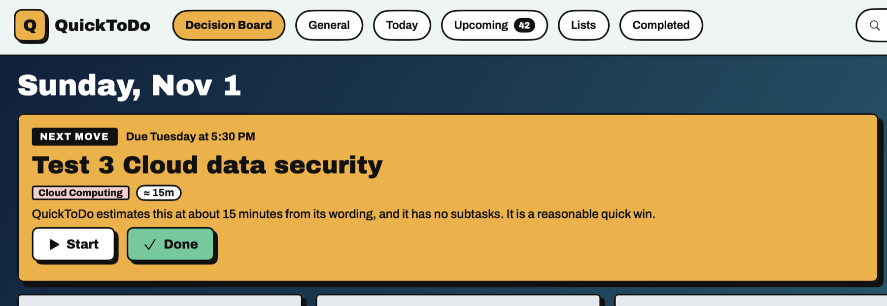
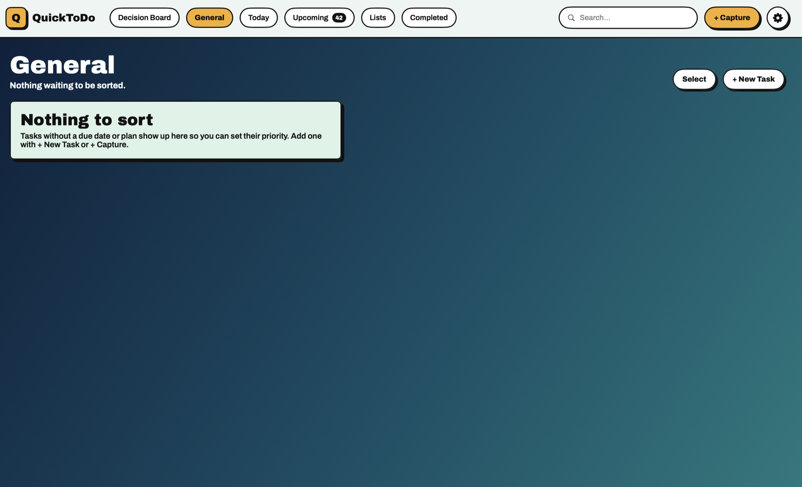
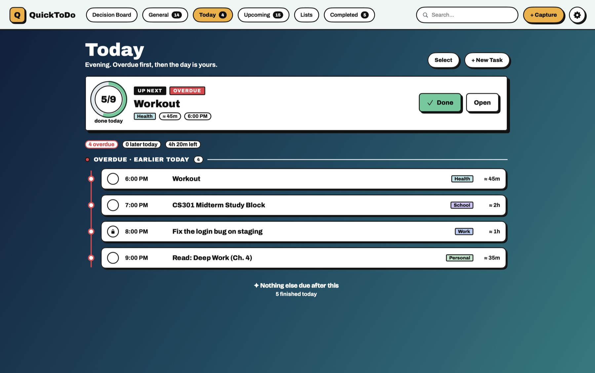
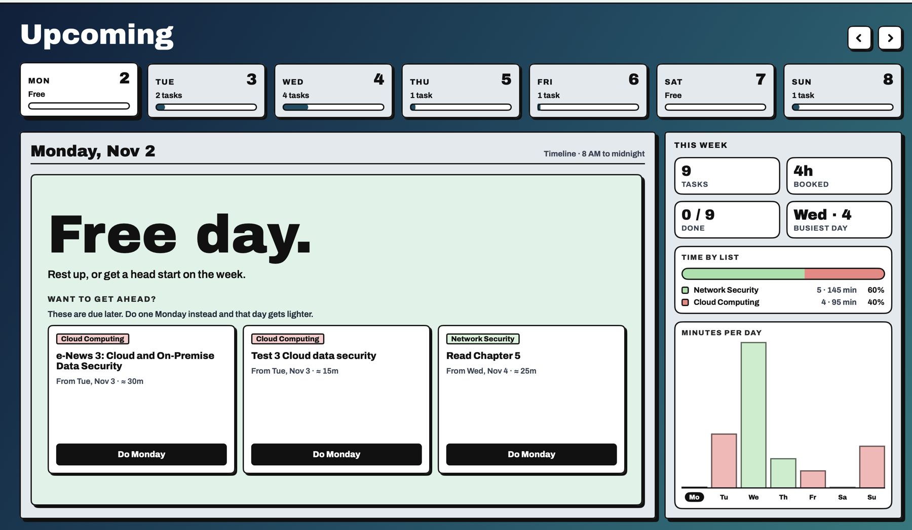
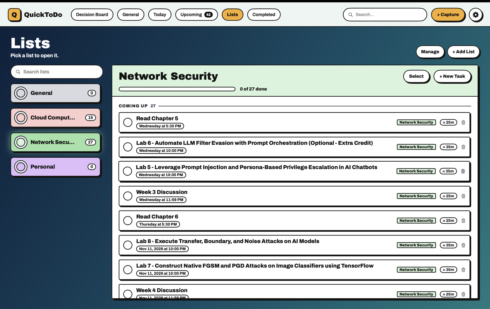
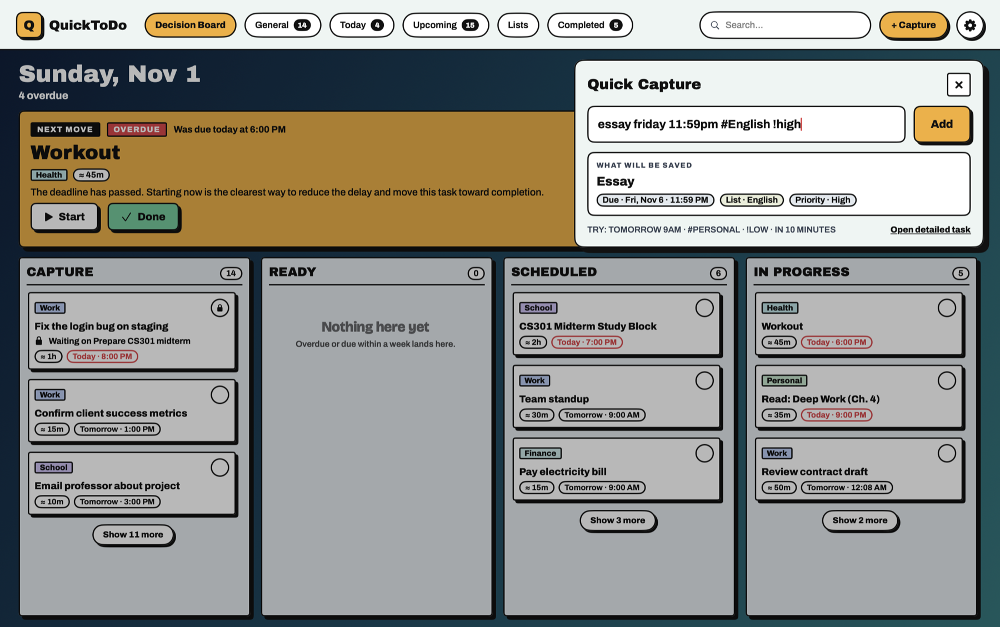
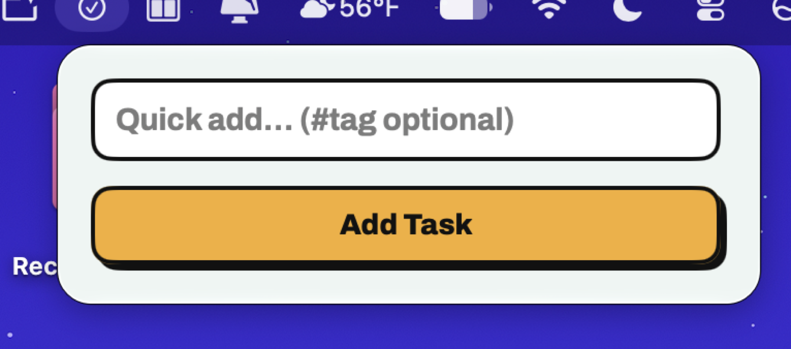
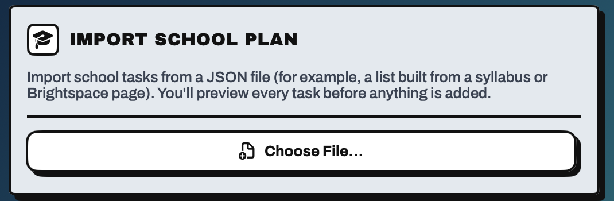

# QuickToDo

**A task app for the days when your list is so long you freeze.**

QuickToDo is a task management app for macOS. It helps you get tasks out of your head, see what to do next, and plan time for the things you enjoy. When the Today screen is empty, it says "Rest is a feature." I mean it.

## Table of contents

- [Why I built this](#why-i-built-this)
- [Who it is for](#who-it-is-for)
- [What it does](#what-it-does)
- [Coming next](#coming-next)
- [Screenshots](#screenshots)
- [How to run it](#how-to-run-it)
- [How to use it in your own workflow](#how-to-use-it-in-your-own-workflow)
- [Importing a school plan](#importing-a-school-plan)
- [Your data](#your-data)
- [Project layout](#project-layout)
- [Running the tests](#running-the-tests)
- [Feedback](#feedback)

## Why I built this

I have trouble focusing. A normal day throws a lot at me. A class deadline, an email, a chore, an idea I don't want to lose. When I can't sort it all, I freeze. I call it task paralysis. I stare at the list and do nothing.

I built QuickToDo to fix that for myself. It's my own workflow, written as an app. I wanted three things:

1. **Get things out of my head fast.** If capturing takes more than a few seconds, I skip it. So I can type a task in plain words from anywhere on my Mac.
2. **See what matters next.** I don't want to pick from 40 items. I want the app to show me one task to start with, and tell me why.
3. **Make room for things I enjoy.** Most to-do lists are all obligations. I plan free time on purpose, so rest and hobbies get a slot too.

Fair warning: this is my own tool, built around my own brain. It might feel a little opinionated. That's on purpose.

This isn't a medical tool. It doesn't treat or cure anything. It's just the setup that helps me get through my days.

If it helps you too, I would love that. You're welcome to use it. You can also borrow any idea in it for your own workflow.

## Who it is for

QuickToDo is for anyone who wants a calm place to keep tasks. It might be you if:

- You juggle classes and deadlines.
- Your task list gets long and you shut down.
- You want fun and rest on the calendar next to work, not squeezed in after it.

You don't need to know how to code to use the app. Building it does take a few steps, and the guide below walks you through each one.

## What it does

Every feature is explained step by step in [docs/features.md](docs/features.md).

- **Quick Add in plain language.** Type `essay friday 11:59pm #English !high` and QuickToDo sets the due date, the list, and the priority for you.
- **Global shortcut.** Press Control, Option, Command and Space from any app to open a small Quick Add window.
- **Menu bar quick add.** Click the QuickToDo icon in your menu bar to add a task without opening the main window.
- **Detailed tasks.** Add notes, a due date, reminders, a time estimate, a priority, a list, and checklist steps. You can also make a task repeat daily, on weekdays, weekly, or monthly.
- **Decision Board.** Your main screen. It shows four columns: Capture, Ready, Scheduled, and In Progress. You can sort them by recommendation, due date, priority, or your own order.
- **Next Move card.** An amber card at the top of the board that shows the one task to do now. An overdue task comes first. If nothing is overdue, the soonest due task wins.
- **Next Move reasons.** The Next Move card gives a one sentence reason for its pick. It only uses details you entered.
- **Focus window.** In Settings, you can set the hours you keep for focused work. Next Move mentions them when a high priority task fits.
- **General.** An inbox for tasks with no due date. It sorts them into High, Medium, and Low lanes. Drag a task between lanes to change its priority.
- **Today.** Shows what's overdue and what's due later today. It has a progress ring and an Up Next card.
- **Upcoming.** A 7 day planner. It shows a timeline for each day. Gaps of 30 minutes or more show up as free time, with a Plan this time button.
- **Week summary.** Shows how many tasks are done this week, how much work is left, and how your time splits across lists.
- **Lists.** Browse tasks by list. Create, recolor, delete, and reorder lists.
- **Dependencies.** Mark a task as waiting on another task, and it stays locked until the first one is done. Next Move skips locked tasks, so you only see what you can do now. See [how dependencies work](docs/features.md#dependencies).
- **Step suggestions.** On Macs that support Apple Intelligence, QuickToDo can suggest 3 to 5 checklist steps for a task. It runs on your Mac. If your Mac doesn't support it, the feature stays hidden.
- **Reminders.** Tasks with due dates send macOS notifications on your Mac: one at the due time, your chosen reminders, and "Still not done" nudges as the deadline gets close. School plan imports get them too, so an upcoming assignment pings you without you checking the app. You can mark a task done or snooze it from the notification. See [Reminders and notifications](docs/features.md#reminders-and-notifications).
- **Completed and Trash.** Finished tasks move to Completed. Deleted tasks sit in Trash for 30 days. Short Undo prompts appear after you complete or delete a task.
- **School plan import.** Load a JSON file of assignments, preview them, and add them in one step. See [Importing a school plan](#importing-a-school-plan).
- **Backup and restore.** Export everything to one JSON file, and bring it back later.
- **Built in help.** A welcome tour and a Help window explain each screen. Open Help from the Help menu.

Keyboard shortcuts are listed in [docs/keyboard-shortcuts.md](docs/keyboard-shortcuts.md).

## Coming next

I plan to add an import to calendar feature. The goal is to see my tasks and my calendar in one place, so I can plan around real commitments. It is not built yet, and nothing in the app does this today.

## Screenshots

### Decision Board



This is the screen I open first. One amber card tells me what to do now. Everything else waits in four columns, out of my way.

### General



General is my junk drawer. Everything lands here first, and I sort it by priority when I have a minute.

### Today



Today is only today. When it's empty, the app tells me rest is a feature, and I believe it.

### Upcoming



Upcoming shows the week. The gaps are my favorite part. Free time gets its own block, so I can plan something fun into it.

### Lists



Lists keep each part of life in its own color: a class, work, or personal.

### Quick Capture



Quick Capture is for when a thought shows up and I have about five seconds. I type it like a text message.

### Menu bar



The menu bar window lets me dump a thought without leaving what I'm doing.

### School plan import



Import School Plan lives in Settings. You choose a file, then check every task in a preview before it's added.

## How to run it

You build QuickToDo yourself from the source code. This needs a Mac and Xcode. Xcode is Apple's free app for building Mac apps. You can get it from the Mac App Store.

### What you need

- A Mac running macOS 26.0 or later.
- Xcode, version 27.0 or newer.

### The short version

1. Install Xcode from the Mac App Store and open it once.
2. On this GitHub page, click the green **Code** button, then **Download ZIP**. Unzip the file.
3. Open the `QuickToDo` folder inside it and double click `QuickToDo.xcodeproj`.
4. Click the **Run** button, the play triangle at the top left.

QuickToDo opens after the first build. It starts empty, so your list is yours from the first task.

If you get stuck, the step by step guide has fixes for common problems: [docs/getting-started.md](docs/getting-started.md).

## How to use it in your own workflow

This is the routine I follow. Take what helps and skip the rest.

1. **Capture.** When a thought shows up, add it right away. Use Quick Add, the shortcut, or the menu bar. Don't sort it yet.
2. **Check Next Move.** Open the Decision Board. Look at the amber card. Start that task.
3. **Sort once a day.** Open General. Give loose tasks a priority or a due date. This takes a few minutes.
4. **Plan the week.** Open Upcoming. Look at each day and the free time blocks. Once the calendar import I plan to build is ready, your calendar events will show up here too.
5. **Protect personal time.** Add things you enjoy as real tasks with a time. Then they show up on your plan next to your work.
6. **Close the day.** Check Today. Finish what you can. Move the rest to a day that has room.

The full version, with examples, is in [docs/daily-workflow.md](docs/daily-workflow.md).

## Importing a school plan

You can load a whole semester of assignments at once. You give QuickToDo a small text file in a format called JSON. It's a simple list of tasks, and you can write one by hand. A sample is in [samples/sample-school-plan.json](samples/sample-school-plan.json).

To import it, open Settings, find **Import School Plan**, and click **Choose File**. You see a preview first, and nothing is added until you approve it. The format is explained in [docs/school-import.md](docs/school-import.md).

## Your data

Everything stays on your Mac, and the app doesn't need an account.

- **Back up:** Open Settings and click **Export Backup**. You get one file. Do this before you reinstall or move to a new Mac.
- **Restore:** Open Settings and click **Import Backup**. Restoring replaces everything in the app, so QuickToDo asks you to confirm first.
- **Start fresh:** Settings has a **Clear Everything** button. It skips Trash, so export a backup first.

## Project layout

```
QuickToDo/
├── README.md
├── docs/
│   ├── getting-started.md
│   ├── features.md
│   ├── daily-workflow.md
│   ├── school-import.md
│   ├── keyboard-shortcuts.md
│   └── screenshots/
├── samples/
│   ├── README.md
│   └── sample-school-plan.json
└── QuickToDo/
    ├── QuickToDo.xcodeproj
    ├── Fonts/
    ├── Assets.xcassets/
    ├── QuickTodoTests/
    └── (Swift source files)
```

## Running the tests

The project has a test target named `QuickTodoTests`. It covers the date parser, the Next Move logic, the planner, and the task model.

1. Open `QuickToDo/QuickToDo.xcodeproj` in Xcode.
2. Press **Command and U**.
3. Open the Test navigator (Command and 6) to see each result.

## Feedback

I would love to hear how it works for you. If you find a bug, have an idea, or just want to tell me what helped, open an issue on the GitHub page. I built this for my own brain, so I'm very curious what works for yours.

## License

QuickToDo is licensed under the [PolyForm Noncommercial License 1.0.0](LICENSE). You can read the code, run it, learn from it, and use it for personal, school, or other noncommercial purposes. You can't sell it or use it in a commercial product. If you want to use it commercially, open an issue and ask.
