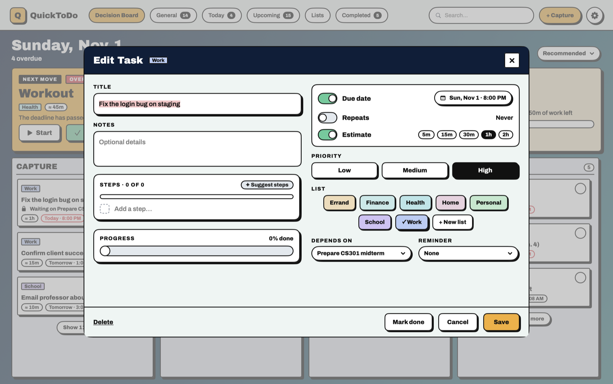

# QuickToDo features guide

This guide explains every feature in QuickToDo, step by step. Each feature says what it is, how to use it, and why it helps. You can read it top to bottom or jump to the part you need.

[Back to the README](../README.md)

## Table of contents

- [Capturing tasks](#capturing-tasks)
- [Task details](#task-details)
- [Dependencies](#dependencies)
- [Next Move and the board stages](#next-move-and-the-board-stages)
- [Planning](#planning)
  - [General](#general)
  - [Today](#today)
  - [Upcoming](#upcoming)
  - [Lists and managing lists](#lists-and-managing-lists)
  - [Completed](#completed)
- [Multi select and bulk actions](#multi-select-and-bulk-actions)
- [Search](#search)
- [Undo and Trash](#undo-and-trash)
- [Reminders and notifications](#reminders-and-notifications)
- [Focus Window](#focus-window)
- [Backup and restore](#backup-and-restore)
- [Help and the welcome tour](#help-and-the-welcome-tour)
- [Menu bar and global shortcut](#menu-bar-and-global-shortcut)
- [Settings at a glance](#settings-at-a-glance)

## Capturing tasks

### Quick Capture

**What it is.** A small window where you type a task in plain words. QuickToDo reads the words and fills in the date, the list, and the priority.

**How to use it:**

1. Click **+ Capture** in the top bar.
2. Type your task. Example: `essay friday 11:59pm #English !high`
3. Look at the **What will be saved** card. It shows the title, due date, list, and priority.
4. Press Return or click **Add**.

Press Escape to close the window. Click **Open detailed task** if you want to add more than the words can say.

**Why it helps.** Capturing takes a few seconds, so you don't skip it.

### The words QuickToDo understands

| You type                                       | What QuickToDo does                                 |
| ---------------------------------------------- | --------------------------------------------------- |
| `today`, `tomorrow`                            | Sets the date. The time is noon unless you give one |
| `friday`, `next monday`, `on tue`              | Sets the next one of those weekdays                 |
| `june 15`, `july 4th`, `march 3 2027`          | Sets that date                                      |
| `2pm`, `10:30 pm`, `at 9am`, `@5pm`, `14:30`   | Sets the time                                       |
| `in 10 minutes`, `in 2 hours`, `in three days` | Sets a time from now                                |
| `#Work`                                        | Files the task in the Work list                     |
| `#[Senior Seminar]` or `#"Senior Seminar"`     | Files it in a list with more than one word          |
| `!high`, `!medium`, `!low`                     | Sets the priority                                   |
| `!!` or `urgent`, `important`, `asap`          | Sets high priority                                  |
| `!`                                            | Sets low priority                                   |

Some details to know:

- A weekday always means the next one. If today is Friday, `friday` means next Friday.
- If you give a time with no date and that time has passed, QuickToDo uses tomorrow.
- You can put `#list` and `!priority` anywhere in the text.
- If you type only `#Work`, QuickToDo makes the Work list and uses "Work" as the title.
- A new `#list` is created the first time you use it. List names ignore capital letters.
- With no list, the task goes in General. With no priority, it's Low.

**Where the task lands.** QuickToDo picks a starting column on the Decision Board. No due date means Capture. Overdue or due within 7 days means Ready. Due later means Scheduled. You can move it after that.

### Detailed Task

**What it is.** The full task form. Use it when you want notes, steps, a reminder, and more.

**How to open it:**

1. Press Command and N, or click **+ New Task** on General, Today, Upcoming, or Lists.
2. Or click **Open detailed task** inside Quick Capture.

After you save, QuickToDo takes you to the task. It stays on your current screen if the task shows there.

**Why it helps.** Quick Capture is for speed. Detailed Task is for the few tasks that need care.

## Task details

Click any task to open the same form in edit mode. The title bar says **Edit Task**. Here is every field.

### Title

The one required field. The **Create Task** button stays dim until you type a title. QuickToDo capitalizes the first letter for you.

### Notes

Free text for extra details. The first line of the notes shows on General's sticky notes and on the Today and Upcoming timelines. Notes are included in reminder notifications, and search looks inside them.

### Steps

**What it is.** A checklist inside the task.

**How to use it:**

1. Type a step in **Add a step** and press Return.
2. Click the box next to a step to tick it off.
3. Click the small x to delete a step.

The header counts your progress, such as **Steps 1 of 3**. If your Mac supports Apple Intelligence, a **Suggest steps** button appears. It adds 3 to 5 steps based on your title and notes. It runs on your Mac and sends nothing out. If your Mac doesn't support it, the button stays hidden.

Ticking a step means you've started. The task moves to In Progress.

**Why it helps.** A big task becomes a few small ones, so you know the first move.

### Progress

**What it is.** A slider for work you can't finish in one sitting, like a lab or a paper. It only appears when you edit an open task.

**How to use it:**

1. Open the task.
2. Click or drag along the bar. It moves in steps of 10 percent.
3. Click **Save**.

Until you move it, the slider shows the share of steps you ticked. Any progress above zero moves the task to In Progress. Setting it to 100 percent completes the task. The card shows a progress bar.

**Why it helps.** You can see a long task moving forward.

### Due date

**What it is.** When the task is due.

**How to use it:** Turn on **Due date**, then pick a date and time.

A due date unlocks Repeats and Reminder. Turning the toggle off clears the date. Overdue dates show in red.

If you push a due date later three times, QuickToDo shows a **Pushed Back Again** alert. It asks if the task is really going to happen. After that, the card shows a small badge such as 3x.

**Why it helps.** The alert is a kind nudge to drop, shrink, or do a task you keep avoiding.

### Repeats

**What it is.** A task that comes back on its own.

**How to use it:**

1. Turn on **Due date** first.
2. Turn on **Repeats**.
3. Pick **Daily**, **Weekdays**, **Weekly**, or **Monthly**.

When you finish the task, the finished one stays in Completed. QuickToDo adds a fresh copy with the next date. The copy keeps the title, notes, list, priority, reminder, and estimate. It doesn't copy steps or a dependency. If you untick the finished task right away, the new copy is removed so you don't get a duplicate. Weekdays skips Saturday and Sunday.

**Why it helps.** You set up a habit once and never retype it.

### Estimate

**What it is.** How long the task takes.

**How to use it:** Turn on **Estimate** and pick 5m, 15m, 30m, 1h, or 2h.

Without an estimate, QuickToDo guesses from your steps and the words in the title and notes. A guess shows with a ≈ sign. Your own estimate is marked as set by you. If you press **Start Now**, QuickToDo times the task. The card then shows **Started 5m ago** and later **Took 12m**. After you finish at least three timed tasks in one list, the estimate's tooltip tells you if that list usually runs long or short.

Tasks of about 20 minutes or less with no steps count as quick wins.

**Why it helps.** Time estimates power the free time blocks, the week totals, and the Quick Win suggestion.

### Priority

Pick **High**, **Medium**, or **Low**. The default is Low. High shows a flag on the card. The Board's Priority sort and General's lanes use it.

### List

**What it is.** The group the task belongs to, such as a class or a hobby.

**How to use it:**

1. Click a list name to choose it. A check mark shows your choice.
2. Or click **+ New list**, type a name, and pick a color.

If you pick no list, the task goes in General.

### Depends on

Pick a task that must be finished first. This feature has its own section: [Dependencies](#dependencies).

### Reminder

**What it is.** A heads up before the task is due.

**How to use it:** Set a due date, then pick **None**, **5 min before**, **10 & 5 min**, or **30, 10 & 5 min**. Without a due date, the field says **Set a due date first**.

See [Reminders and notifications](#reminders-and-notifications) for everything that gets sent.

### The footer buttons

- **Create Task** or **Save** keeps your changes. Pressing Return in the title field also saves.
- **Cancel** closes the form and drops your changes.
- **Mark done** completes the task. In edit mode, it turns into **Done, mark not done** for finished tasks.
- **Delete** moves the task to Trash. It only shows in edit mode.

### What you see on a task card

A card can show these things:

- A circle to complete the task. Click it for confetti, a green flash, and a short sound.
- The title, with a line through it once done.
- The list name in its color.
- The due date. It turns red when overdue.
- The time estimate, or the real time once you've started.
- A flag for High priority.
- A link badge with a number on a task that other tasks wait for.
- An hourglass and the name of the task this one waits for.
- A repeat symbol on repeating tasks.
- A progress bar for steps or percent.
- A trash button when you hover.

### The right click menu

Right click a task card for quick actions:

- **Mark Done** or **Mark Not Done**
- **Edit**
- **Move to Today** and **Move to Tomorrow**
- **Start Now** (moves it to In Progress)
- **File as Someday** (clears the due date and reminders, and sends it to Capture)
- **Move to Column** (Capture, Ready, Scheduled, or In Progress)
- **Delete**

Rows on the Today and Upcoming timelines have a shorter menu: Mark Done, Edit, and Delete.

**Why it helps.** You can sort a task without opening it.

## Dependencies

### What it is

A dependency says one task must be finished before another. QuickToDo calls the second task blocked. It stays blocked until the first one is done.

### A simple example

You're planning a party. You have two tasks:

1. **Book the venue**
2. **Send invitations**

You can't send invitations until you know the venue. So you tell QuickToDo that **Send invitations** depends on **Book the venue**.

### How to set it

1. Open **Send invitations**. This is the task that has to wait.
2. Find the **Depends on** dropdown on the right side.
3. Click it and choose **Book the venue**.
4. Click **Save**.

The dropdown lists your other open tasks. It starts at **Nothing**. A task can wait on one other task. Many tasks can wait on the same one.

If you hover over the dropdown, it reminds you: "This task can't be marked done until the one you pick is."



### What you see while a task is blocked

- The circle on the card shows a lock instead of staying empty.
- On the Decision Board and in General, the card says **Waiting on Book the venue**.
- In Lists, an hourglass badge shows the name of the task it waits for.
- Hover over the circle on a card. A tooltip says "Book the venue" must be completed before this.
- On the Today and Upcoming timelines, you see the lock, and the tooltip says **Waiting on another task**.
- The task that blocks others shows a link badge with a number in Lists. Hover over it to see their names.

### What happens if you try to finish it early

QuickToDo stops you and shows an alert called **Can't Complete Yet**. It reads: "Book the venue" must be completed before "Send invitations".

Other places follow the same rule:

- **The progress slider.** You can drag it, but it stops at 99 percent while the task is blocked.
- **Bulk Mark Done.** Blocked tasks are skipped quietly. The rest are completed.
- **Next Move.** The card never picks a blocked task. If everything left is blocked, the card says **No next move yet** and explains that what's left is waiting on another task.
- **Up Next on Today.** It skips blocked tasks too.

### What happens when the first task is done

When you complete **Book the venue**, the lock disappears from **Send invitations**. You can complete it, and Next Move can pick it. If you untick **Book the venue** later, **Send invitations** is blocked again. If you delete **Book the venue**, nothing blocks **Send invitations** anymore.

### How to remove it

1. Open the blocked task.
2. Open **Depends on** and choose **Nothing**.
3. Click **Save**.

### Loops are prevented

Say A waits for B, and B waits for C. QuickToDo won't let C wait for A. Those tasks are left out of the dropdown, so you can't make a loop. A task also can't wait for itself, and finished tasks aren't listed.

### Tasks that block others rank higher

On the Decision Board, the **Recommended** sort gives a task extra weight for each task waiting on it. A task that unlocks others rises in its column.

### Why it helps with overwhelm

A long list is stressful because everything looks equally ready. Dependencies hide the tasks you can't do yet. You see fewer choices, so the next step is clear. You also stop worrying that you forgot an order of steps.

## Next Move and the board stages

### The Decision Board

**What it is.** Your main screen. It shows the Next Move card, a This week card, and four columns.

**The four columns:**

| Column          | What lands there                                       |
| --------------- | ------------------------------------------------------ |
| **Capture**     | Tasks with no due date, and tasks you filed as Someday |
| **Ready**       | Tasks that are overdue or due within 7 days            |
| **Scheduled**   | Tasks due more than 7 days away                        |
| **In Progress** | Tasks you started                                      |

A fifth stage, **Completed**, holds finished tasks. You see it in the Completed tab.

How a task moves:

- QuickToDo picks a first column when the task is made.
- Once a day, when the app opens, Scheduled tasks that are now within 7 days move up to Ready.
- Everything else is up to you. A column you choose always sticks.

**How to use the board:**

1. Drag a card onto another column to change its stage.
2. Drag a card onto another card to reorder them.
3. Or right click a card and use **Move to Column**.
4. Click **Show more** at the bottom of a column to see every card. Each column shows three at first.
5. Click **✓ N done** at the bottom of a column to see what you finished from it. Click **undo** next to a task to put it back.

The header shows today's date and how many tasks are overdue. A number chip on each column counts its cards.

**Sort menu.** The menu at the top right sets the order inside every column:

- **Recommended** scores each task. Overdue adds the most. Due within a day adds some. High priority adds some. Each task waiting on it adds a little.
- **Due Date** puts the soonest first.
- **Priority** puts High first.
- **Manual** keeps your drag order. Dragging a card to reorder switches to Manual for you.

**Why it helps.** Each column answers one question. The board shows where every task stands.

### The Next Move card

**What it is.** The amber card at the top. It shows one task to do now.

**How QuickToDo picks it:**

1. It looks at every open task that isn't blocked.
2. If any are overdue, it picks the one that has been overdue longest.
3. If none are overdue, it picks the soonest due.
4. Tasks with no due date come last.

Priority, estimates, and your focus window don't change which task is chosen. They change the explanation under the title. Your search text narrows the pool too.

**What you can do:**

- Click **Start** to move the task to In Progress and start its timer.
- Click **Done** to complete it.
- Click the title to open the task.

An **OVERDUE** tag shows when the task is late.

**What the explanation sentence means.** The sentence under the title depends on the task:

| The card says                                                                                   | Why                                |
| ----------------------------------------------------------------------------------------------- | ---------------------------------- |
| The deadline has passed. Starting now is the clearest way to reduce the delay.                  | The task is overdue                |
| This task is due within four hours.                                                             | The deadline is close              |
| You configured a focus window today, this task is high priority, and it's long.                 | See [Focus Window](#focus-window)  |
| You estimated this at 15 minutes and it has no subtasks. It is a reasonable quick win.          | A short task with no steps         |
| You marked this high priority, but it has no explicit estimate or subtasks. Add concrete steps. | A big, important task with no plan |
| This task has no due date and is not high priority. Filing it in General keeps it available.    | Nothing is pulling on it           |
| Its due date is in the future. Keep it scheduled.                                               | A task with a date that's far off  |
| You marked this task high priority, but it has no due date. Schedule it.                        | High priority with no date         |

The actions behind those sentences are Start Now, Quick Win, Break Into Steps, File for later, and Schedule.

**Why it helps.** You don't choose from 40 items. One task is picked, and you know why.

### The This week card

The sand card beside Next Move shows tasks done out of tasks due this week, and how much work is left. The week runs from today through the next 6 days. It also counts open overdue tasks.

## Planning

### General

**What it is.** The inbox for tasks that have no plan yet. It shows every task in the Capture stage.

**How to use it:**

1. Open **General**. You see three lanes: High, Medium, and Low.
2. Each lane header shows how many notes it holds and the total time.
3. Drag a note to another lane. A dashed box says **Drop to make high** (or medium, or low).
4. Or open a task, give it a due date, and it leaves General for the board.

Notes take the color of their list. A line under the page title changes with the size of the pile.

**Why it helps.** Sorting by priority takes a few minutes and clears your head.

### Today

**What it is.** Everything overdue plus everything due later today.

**What you see:**

- A progress ring that counts tasks done today out of the total.
- An **Up Next** card with **Done** and **Open** buttons. It skips blocked tasks.
- Three chips: how many are overdue, how many are due later today, and how much time is left.
- A timeline with sections: **Overdue, earlier days**, **Overdue, earlier today**, and **Later today**. Overdue ones sit on a red line.

**Why it helps.** You see only what needs you today. Tomorrow's work stays out of the way.

The number on the Today tab and the badge on the Dock icon use the same count.

### Upcoming

**What it is.** A planner for the days after today.

**How to use it:**

1. Open **Upcoming**. A strip shows 7 days, starting tomorrow.
2. Click a day. Each tile shows the number of tasks, or **Free** or **All done**. A bar shows how loaded the day is.
3. Use the arrow buttons for the previous or next 7 days. Left and right arrow keys change the day.
4. Read the timeline. It runs from 8 AM to midnight. Tasks with no clock time appear first, marked **Anytime**.
5. Find a free block. Gaps of 30 minutes or more show as **free**. Click **+ Plan this time**. Quick Capture opens with that time filled in.

**Free days.** If a day has nothing, you see **Free day**. Under **Want to get ahead?**, QuickToDo lists up to three later tasks. Click **Do** and the day name. The task moves to that day. It keeps its time, or uses 5 PM, or the next half hour if that time has passed.

**The This week panel.** It shows tiles for Tasks, Booked time, Done, and Busiest day. A bar shows **Time by list**. A chart shows **Minutes per day**.

Finished tasks collapse into a **✓ completed** pill. Finishing a task never merges its time into free time.

**Why it helps.** You see which days are packed and where there's room for rest.

### Lists and managing lists

**What it is.** A way to browse tasks by area, such as a class, work, or personal.

**How to browse:**

1. Open **Lists**. The left side has one pill per list.
2. Each pill shows a progress ring and the number of open tasks. A red dot means something is overdue.
3. Type in **Search lists** to filter the pills.
4. Click a list. The right side shows its open tasks in groups: **Overdue**, **Later today**, **Coming up**, and **No date**.
5. A bar shows how many tasks in that list are done.
6. Drag a pill to reorder the lists.

**Add a list:**

1. Click **+ Add List**.
2. Type a name. The limit is 24 letters.
3. Pick one of six colors, or choose a custom color.
4. Check the preview and click **Create Category**.

If the name already exists, QuickToDo changes that list's color instead of making a copy.

**Manage lists:**

1. Click **Manage**.
2. Drag the rows to reorder them.
3. Click a color swatch to recolor a list. Choose **Custom** for any color.
4. Right click a row and choose **Delete Category**. QuickToDo asks first. Tasks in that list move to General.
5. Click **Save**.

The General list can't be deleted and doesn't appear in Manage. You can't rename a list in the app today. To change a name, make a new list and move the tasks.

**Why it helps.** Each area of life gets its own space, and the colors make it easy to scan.

### Completed

**What it is.** A record of finished tasks, grouped by **Today**, **Yesterday**, **This Week**, and **Older**.

**How to use it:**

- Click a circle to mark a task not done. It goes back to the column it came from.
- Click **Select** to restore or delete several at once.
- Click **Clear Completed** to delete them all. QuickToDo asks first. This skips Trash.

**Why it helps.** You can see what you got done, and you can undo a mistake.

## Multi select and bulk actions

**What it is.** A way to act on many tasks at once.

**Where it works.** General, Today, Lists, and Completed. The Decision Board and Upcoming don't have it.

**How to use it:**

1. Click **Select** at the top right.
2. Click each task you want. A check shows on the ones you picked.
3. Use the bar that appears. It shows **N selected**.
4. Click **Mark Done** or **Delete**. In Completed, you see **Restore** and **Delete**.
5. Click **Cancel** to leave select mode.

What to know:

- Blocked tasks are skipped by **Mark Done**, with no alert.
- Deleted tasks go to Trash. The Undo prompt only covers the last one, so restore the others from Trash.
- Bulk Mark Done doesn't show an Undo prompt. Use the Completed tab to undo.

**Why it helps.** You clear a pile in seconds.

## Search

**What it is.** Two kinds of search.

**The top bar search.** Type in **Search** at the top.

- It filters the screen you're on, by title and notes.
- It clears when you switch tabs.
- Lists has its own **Search lists** box for the list names.

**Find Task.** Press Command and F, or choose **Tasks, Find Task**.

1. Type a word. QuickToDo searches every open and completed task, by title and notes.
2. Click a result, or press Return for the first one.
3. QuickToDo takes you to the task. It switches tabs only if the task isn't shown where you are.

**Why it helps.** You can find a task even when you forgot which list it's in.

## Undo and Trash

**What it is.** A safety net for mistakes.

**Undo prompts.** A short message appears at the bottom for about 5 seconds:

- **Marked done** with an **Undo** link. An undone task goes back to the column it was in.
- **Task deleted** with an **Undo** link.
- **Restored** with an **Undo** link, after you restore from Trash.

**Trash.** A deleted task isn't gone. It moves to Trash.

1. Press Shift, Command and T, or choose **Go, Trash**.
2. Click **Restore** to bring a task back.
3. Click the red trash can to delete one forever. QuickToDo asks first.
4. Click **Empty Trash** to delete everything in it. QuickToDo asks first.

After 30 days, QuickToDo removes old items from Trash when the app opens. Deleting a task also cancels its reminders. Restoring brings them back.

**Why it helps.** You can act fast without fear.

## Reminders and notifications

**What it is.** Alerts from macOS for tasks with a due date in the future.

**How to set one up:**

1. Open a task and turn on **Due date**.
2. Pick a **Reminder**. Or leave it as **None**.
3. Click **Save**. The first time, macOS asks if QuickToDo can send notifications. Click Allow.

**What gets sent.** Every task with a future due date gets these:

- A notification at the due time, with the title and your notes.
- Your chosen reminders. They say **Upcoming** and the task name, such as "Due in 10 minutes."
- A **Still not done** nudge at 24, 12, 6, 3, and 1 hour before the due time. Only the ones still ahead are sent.

**Buttons on a notification:**

- **Mark Done** completes the task. It needs your Mac to be unlocked. A task that is waiting on another task is left alone.
- **Snooze 5 min** moves the due date to 5 minutes from now.

Reminders are canceled when you complete or delete a task. They come back if you undo.

**The Dock badge.** The QuickToDo icon in the Dock shows the number of overdue tasks plus tasks due today.

**Check your status.** Open **Settings** and find the **Notifications** card. It shows **Enabled**, **Off**, or **Not requested**.

- **System Settings** opens the macOS notification settings.
- **Check Again** refreshes the status.

**Why it helps.** You don't have to remember. The app does.

## Focus Window

**What it is.** The hours you keep for deep work. QuickToDo uses them only when you turn them on.

**How to set it:**

1. Open **Settings**.
2. In the **Focus Window** card, turn on **Preferred focus hours**.
3. Set **From** and **To**. The starting times are 7 PM and 9 PM.

**What it changes.** The window only changes the Next Move explanation. If a task is high priority, due within a week, and about an hour or longer, the card says **Use your focus window**. This only happens while the window is still ahead today or running now.

**Why it helps.** Your hardest task gets your best hours.

## Backup and restore

**What it is.** Your data lives only on your Mac. A backup is one file you keep somewhere safe.

**Export a backup:**

1. Open **Settings**.
2. In the **Backup** card, click **Export Backup**.
3. Pick where to save. The file is named like `QuickToDo Backup 11-1-2026.json`.

The file holds every task, every list, Completed tasks, and Trash.

**Restore a backup:**

1. Click **Import Backup** and pick your file.
2. QuickToDo shows **Replace All Data?** with the number of tasks and lists inside.
3. Click **Replace Everything** to continue, or **Cancel**.

Restoring replaces everything now in the app, and it can't be undone. QuickToDo sets up reminders again for open tasks with a future due date.

**Clear everything.** In the **Reset** card, click **Clear Everything**. QuickToDo asks you to confirm. It deletes all tasks and lists and skips Trash. A fresh General list is made so the app still works.

**Import School Plan.** The **Import School Plan** card loads assignments from a JSON file, with a preview before anything is added. See [Importing a school plan](school-import.md).

**Why it helps.** A backup lets you move to a new Mac without losing a thing.

## Help and the welcome tour

**The welcome tour.** It opens the first time you run QuickToDo. It has four pages: Welcome, Capture in plain language, See the decision, and Choose one clear next move.

- Click **Next** and **Back**, or swipe left and right.
- Click **Skip** to close it. The last page has **Get Started**.
- To see it again, open **Settings** and click **Replay Welcome** in the **Help** card.

**The Help window.** It explains every screen in short topics.

1. Choose **Help, QuickTodo Help** from the menu bar.
2. Or open **Settings** and click **Open Help**.

**Why it helps.** Help is one click away when you forget how something works.

## Menu bar and global shortcut

### The global shortcut

**What it is.** A floating Quick Add window you can open from any app.

**How to use it:**

1. Press Control, Option, Command and Space.
2. Type your task using the same plain words as Quick Capture.
3. Check the chips for date, list, and priority.
4. Press Return to add it, or Escape to close.

Press the keys again to hide the window. You can also open it from **Tasks, Quick Capture**. The keys are fixed. Settings shows them, but you can't change them.

### The menu bar icon

**What it is.** A checkmark icon in your menu bar with a small Quick Add box.

**How to use it:**

1. Click the QuickToDo icon in the menu bar.
2. Type a task, such as `email Sam tomorrow #Work !medium`.
3. Press Return or click **Add Task**.

If the main window is open, QuickToDo shows you the new task.

**Why it helps.** You capture a thought without leaving what you're doing.

### The Shortcuts app and Spotlight

QuickToDo adds two actions you can use in the Shortcuts app, Spotlight, or Siri:

- **Quick Add a Task** opens the Quick Add window.
- **What's My Next Move** tells you which task to do next and why. It skips tasks that are waiting on another task.

### Complete a task from a link

A link like this marks an open task done:

```
quicktodo://complete?title=Read%20chapter%203&course=School
```

A task that is waiting on another task is not completed by the link. The `title` is the task name. The `course` is the list name, and it's optional. Use it to tell apart tasks that share a title.

## Settings at a glance

Open Settings with Command and comma, or click the gear icon at the top right. It has these cards:

| Card                   | What it does                                                                |
| ---------------------- | --------------------------------------------------------------------------- |
| **General**            | Turns the completion sound on or off, and sets QuickToDo to launch at login |
| **Quick Capture**      | Shows the global shortcut                                                   |
| **Focus Window**       | Sets your focus hours                                                       |
| **Notifications**      | Shows reminder status and links to System Settings                          |
| **Help**               | Opens Help and replays the welcome tour                                     |
| **Import School Plan** | Loads a JSON file of assignments                                            |
| **Backup**             | Exports and imports a backup file                                           |
| **Reset**              | Clears everything                                                           |
